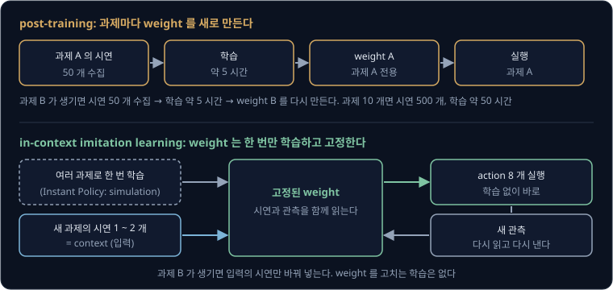
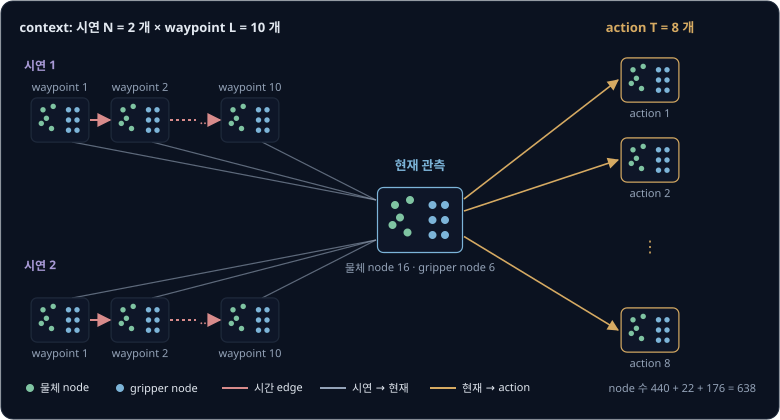
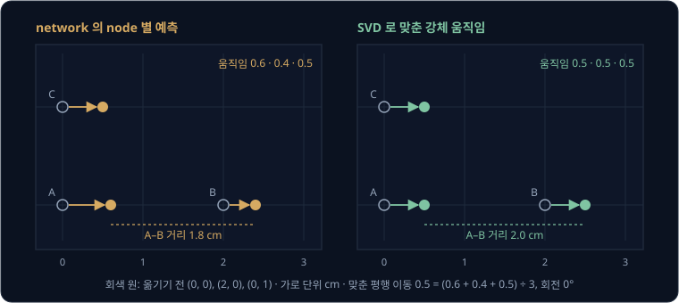
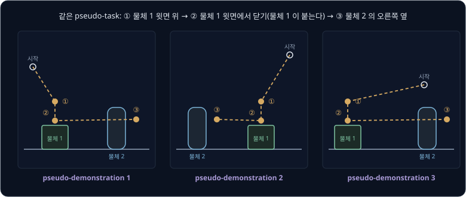
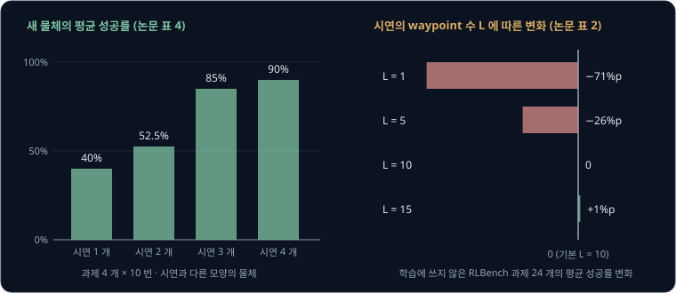

# In-Context Imitation Learning

[ACT](../act/README.md) 논문의 저자들은 리모컨에 배터리를 끼우는 과제 하나를 가르치려고 사람이 조종한 시연 50 개를 모으고, GPU 한 장으로
약 5 시간 학습했다. 같은 로봇에게 컵을 쌓게 하려면 컵 쌓기 시연을 새로 모아 다시 학습해야 하고, [Diffusion Policy](../diffusion-policy/README.md)
도 과제마다 이 과정을 되풀이한다. 사람은 남이 한두 번 해 보이는 것을 보고 바로 따라 하는데, 로봇도 새 작업의 시연을 한두 번 본 직후에
학습 없이 그 작업을 할 수는 없을까?

이 강의는 시연을 학습 데이터가 아니라 network 의 입력으로 넣어 이 문제를 푸는 in-context imitation learning 을 다룬다. 2024 년 Vosylius 와
Johns 가 발표한 Instant Policy 는 시연 2 개를 입력으로 받아, Sawyer 로봇팔로 16 가지 일상 작업을 10 번씩 시도해 평균 88.75% 성공했다.
실물 point cloud 에 맞추려고 다른 과제 5 개의 실물 시연으로 한 번 더 학습해 둔 모델이고, 시험한 과제마다 따로 학습하지는 않았다.

## 학습 목표

- 과제마다 weight 를 고치는 post-training 과, 시연을 입력으로 넣는 in-context imitation learning 이 새 과제를 배우는 방식의 차이를 설명할 수 있다
- Instant Policy 가 시연·현재 관측·앞으로의 action 을 graph 하나로 엮고, diffusion 으로 action node 의 위치를 만드는 과정을 설명할 수 있다
- 실제 과제가 아닌 pseudo-demonstration 으로 "시연을 읽는 법" 을 학습할 수 있는 이유를 설명할 수 있다
- 시연의 수·길이·물체가 성공률을 바꾸는 방식과, 다른 몸·language 로 넓힐 때의 한계를 숫자로 말할 수 있다

## 작업마다 하는 post-training

ACT 와 Diffusion Policy 는 시연의 (관측, action) 쌍을 정답으로 삼아 network 의 weight 를 고친다. 학습이 끝난 weight 에는 "이 장면에서는
이렇게 움직인다" 는 규칙이 과제 하나에 맞춰 들어 있어서, 다른 과제를 시키려면 그 과제의 시연을 모아 weight 를 다시 고쳐야 한다.

여러 과제의 데이터로 미리 학습한 큰 모델도 사정이 크게 다르지 않다. 많은 데이터로 미리 학습하는 단계를 **pretraining** 이라 하고, 그
모델을 특정 과제의 데이터로 더 학습하는 단계를 **post-training**(또는 fine-tuning)이라 한다. [π0](../pi0/README.md) 의 저자들은 작업마다
post-training 할 때 가장 단순한 작업에 5 시간, 가장 복잡한 작업에 100 시간 넘는 데이터를 썼다. Instant Policy 논문은 ALOHA Unleashed 를
근거로 들어 지금의 behavior cloning 방법이 과제마다 시연 수백 ~ 수천 개를 쓴다고 적었다. 반면 ACT 는 실물 과제 대부분에 시연 50 개를 썼다(Thread Velcro 만 100 개).

ACT 논문의 숫자로 과제가 늘 때 드는 양을 계산하면 아래와 같다.

| | 과제 1 개 | 과제 10 개 |
| --- | --- | --- |
| 모으는 시연 | 50 개 | $10 \times 50 = 500$ 개 |
| 학습 시간(RTX 2080 Ti 한 장) | 약 5 시간 | $10 \times 5 =$ 약 50 시간 |
| 실행 전에 하는 일 | 시연 수집 → 학습 | 과제마다 시연 수집 → 학습 |

과제마다 weight 를 새로 만들기 때문에 시연과 학습 시간이 과제 수에 비례해 늘어난다. 과제 10 개를 가르치려면 시연 500 개와 학습 약
50 시간이 들고, 그동안 로봇은 새 과제를 하지 못한다.

## in-context learning

과제 정보를 weight 대신 입력에 넣을 수 있다면 새 과제가 생겨도 weight 를 고칠 필요가 없다. GPT-3 같은 큰 language model 은 이렇게
동작한다. "사과 → apple, 고양이 → cat, 책상 → ?" 처럼 예시 몇 개를 질문 앞에 붙여 넣으면, 번역을 따로 학습시키지 않아도 예시의 규칙을 따라
"desk" 를 낸다.

질문과 함께 입력에 넣는 예시를 **context** 라 하고, weight 를 고치지 않고 context 의 예시만 보고 새 과제를 하는 것을 **in-context learning**
(ICL)이라 한다. 로봇 시연을 context 로 넣어 새 작업을 하게 하는 것이 **in-context imitation learning**(ICIL)이다. 시연이 하나면 one-shot,
몇 개면 few-shot 이라고 부른다.

Instant Policy 의 입력과 출력은 아래와 같다.

| | Instant Policy 의 기본 설정 |
| --- | --- |
| context | 새 과제의 시연 $N = 2$ 개, 시연마다 waypoint $L = 10$ 개 |
| waypoint 하나 | 그 순간의 관측과 action |
| 현재 입력 | 지금의 관측(물체의 3D 점, gripper 의 위치·방향, 열림·닫힘) |
| 출력 | 앞으로 실행할 action $T = 8$ 개 |

**waypoint** 는 시연 trajectory 에서 골라 낸 지점이다. 이 설정에서 network 는 매번 시연 2 개의 waypoint $2 \times 10 = 20$ 개와 지금의 관측을
함께 읽고 action 8 개를 낸다. 공개한 simulation 실행 코드는 action 8 개를 모두 실행한 뒤 바뀐 관측으로 다시 읽고 다시 내는데, 이렇게 관측을 계속 반영하는 실행을 closed-loop
라 한다.

| | behavior cloning (ACT, Diffusion Policy) | in-context imitation learning |
| --- | --- | --- |
| network 의 입력 | 현재 관측 | 새 과제의 시연 + 현재 관측 |
| 과제 정보가 있는 곳 | weight | 입력의 시연 |
| 새 과제가 생기면 | 시연 수집 → 학습 | 시연 1 ~ 2 개를 입력에 넣는다 |
| weight 를 고치는 학습 | 과제마다 | 여러 과제로 한 번 |

ICIL 모델의 weight 에는 특정 과제의 규칙이 아니라 "시연을 보고 지금 해야 할 action 을 알아내는 법" 이 들어 있어야 한다. 과제를 푸는 법
대신 과제를 배우는 법을 학습하는 것을 **meta-learning** 이라 하는데, ICIL 의 학습이 meta-learning 이다. Machenta 는 Implicit Graph Alignment 와
Instant Policy 를 자기들의 초기 연구로 소개하는 회사다. 이 회사는 두 방식의 차이를 "과제 하나를 배우도록" weight 를 고치는 post-training 과 "새 과제를 배우는 법을 배우도록" weight 를 고치는
학습으로 설명했다.

> **오해** in-context imitation learning 은 시연을 넣을 때마다 그 시연으로 weight 를 조금씩 fine-tuning 한다.
>
> **사실** 실행할 때는 weight 를 전혀 고치지 않고 시연을 입력으로만 읽는다. Instant Policy 는 시연을 넣은 직후 학습 단계 없이 바로 action 을 낸다.

시연을 읽는 법은 과제 하나로는 배울 수 없다. 같은 과제의 시연 여러 개를 가진 서로 다른 과제가 아주 많이 있어야 하는데, language model 은
인터넷의 글에서 이런 예시를 얻지만 로봇에는 그런 dataset 이 없다. Instant Policy 가 이 학습에 쓴 데이터는 trajectory 약 70 만 개에 해당하고,
ACT 가 과제 하나에 쓴 시연 50 개의 14,000 배다.

## 시연을 읽는 graph

network 는 시연 20 개 waypoint 와 지금의 관측을 보고, 지금이 시연의 어느 단계에 해당하는지와 gripper 가 물체의 어느 부분에 대해 어디로 가야
하는지를 알아내야 한다. 데이터가 적은 로봇에서는 이 비교를 network 가 처음부터 스스로 찾게 두기보다, 비교할 구조를 입력에 미리 넣어 두는
편이 낫다. 이렇게 미리 넣어 두는 가정을 inductive bias 라 한다. Instant Policy 는 시연·관측·action 을 graph 하나로 엮어 이 구조를 넣는다.

**graph** 는 점(**node**)과 두 점을 잇는 선(**edge**)으로 이루어진 자료 구조다. node 마다 숫자 묶음(feature)이 붙고, edge 에도 두 node 의
관계를 나타내는 숫자를 붙일 수 있다.

관측 하나는 아래처럼 node 22 개의 작은 graph(local graph)가 된다.

- 물체 node 16 개: depth 카메라로 얻은 3D 점의 모음을 point cloud 라 하고, 과제에 쓰이는 물체의 점만 골라 낸 것을 segmented point cloud 라
  한다. 점 2048 개로 줄인 segmented point cloud 에서 서로 멀리 떨어진 점 16 개를 고르고, 그 둘레의 모양을 숫자 묶음으로 요약해 node 의
  feature 로 붙인다. 요약하는 encoder 는 미리 학습해 고정해 둔다
- gripper node 6 개: gripper 위의 정해진 점 6 개를 지금 gripper 의 위치·방향으로 옮겨 놓은 자리에 둔다. feature 에는 어느 점인지와 gripper 가
  열렸는지 닫혔는지를 담는다
- edge: 물체 node 와 gripper node 를 잇고, 두 node 의 상대 위치를 붙인다

local graph 여러 개를 아래처럼 잇는다.

| 연결 | 잇는 node | 전하는 정보 |
| --- | --- | --- |
| 시연 안의 시간 edge | 한 시연에서 이웃한 waypoint 의 gripper node | gripper 가 어떻게 움직였는지 |
| 시연 → 현재 edge | 모든 시연의 gripper node → 현재 gripper node | 시연의 정보를 지금 장면으로 |
| 현재 → action edge | 현재 gripper node → action 의 gripper node | 지금에서 앞으로의 움직임 |

action 은 따로 숫자로 내지 않고, 그 action 을 실행했을 때 gripper 가 놓일 자리에 gripper node 를 옮겨 놓은 local graph 로 나타낸다. 그래서
관측과 action 이 같은 graph 공간에 놓이고, action 을 만드는 일은 action 의 gripper node 를 어디에 둘지 정하는 일이 된다.

기본 설정($N = 2$, $L = 10$, $T = 8$)의 node 수를 세면 시연 local graph 가 $2 \times 10 = 20$ 개라 $20 \times 22 = 440$ 개, 현재 관측이 22 개,
action local graph 가 $8 \times 22 = 176$ 개라서 모두 638 개다. 시연의 gripper node 는 $2 \times 10 \times 6 = 120$ 개인데, 시연을 5 개로
늘리면 $5 \times 10 \times 6 = 300$ 개가 되어 현재 gripper node 로 들어오는 선도 시연 수에 비례해 는다. 반면 기본 설정의 node 638 개를
모두 서로 이으면 순서 있는 짝이 $638 \times 637 = 406{,}406$ 쌍이 된다. 저자들은 처음에 이렇게 모든 node 를 잇는 graph 를 시도했는데,
간단한 과제에서도 결과가 좋지 않았다고 적었다.

edge 에는 절대 위치가 아니라 두 node 의 상대 위치만 붙고, point cloud 도 gripper 기준 좌표로 나타낸다. 시연에서 컵 손잡이의 3 cm 위에
있던 gripper 와 실행 때 다른 자리로 옮긴 컵 손잡이의 3 cm 위에 있는 gripper 는 edge 의 숫자가 같아서, 물체가 놓인 자리가 시연과 달라도
같은 단계로 읽힌다.

### graph transformer

node 의 feature 는 이웃 node 의 feature 를 섞어 고친다. Instant Policy 는 [Transformer](../transformer/README.md) 의 attention 처럼 이웃마다
점수를 매기고 softmax 로 비율을 정해 섞는 graph transformer 를 쓰는데, 점수와 섞는 값에 edge 의 상대 위치도 함께 넣는다. 현재 gripper node 가
시연의 gripper node 셋을 보고 점수 2.0, 0.5, 0 을 매겼다면 softmax 비율은 아래와 같다.

| 시연의 gripper node | 점수 | $e^{\text{점수}}$ | 비율 |
| --- | --- | --- | --- |
| 손잡이로 다가가는 단계 | 2.0 | 7.389 | $7.389 \div 10.038 = 0.74$ |
| 손잡이를 잡는 단계 | 0.5 | 1.649 | $1.649 \div 10.038 = 0.16$ |
| 컵을 내려놓는 단계 | 0 | 1.000 | $1.000 \div 10.038 = 0.10$ |

현재 node 는 다가가는 단계의 정보를 74% 가져온다. 저자들은 전화기를 거치대에 놓는 과제의 두 시점에서 학습한 모델의 attention 비율을 그려 보이고,
모델이 지금이 과제의 어느 단계인지 따라가며 시연에서 그 단계에 해당하는 부분에 높은 비율을 준다고 해석했다(논문 그림 5).

node 와 edge 는 종류가 여럿이다. 종류마다 다른 weight 를 쓰는 graph 를 heterogeneous graph 라 하는데, 저자들은 모든 종류에 같은 weight 를
쓰고 종류 표시만 붙인 graph 가 같은 parameter 수에서 훨씬 나빴다고 적었다. network 는 graph transformer 셋을 차례로 쓴다. 첫째가 각
local graph 안에서 물체 정보를 gripper node 로 모으고, 둘째가 시연의 정보를 현재 gripper node 로 모으고, 셋째가 그 정보를 action node 로
보낸다. 셋은 각각 층 2 개, 크기 1024, head 16 개다.

<b>심화: edge 의 sin·cos 표현과 attention 식</b>

edge 에 상대 위치 $\delta$ 를 그대로 붙이면 1 cm 의 차이가 숫자로 아주 작게 보인다. 저자들은 $\delta$ 를 여러 배율의 sin·cos 로 바꿔 붙였다.

$$
e_{ij} = \big(\sin(2^0 \pi \delta),\ \cos(2^0 \pi \delta),\ \sin(2^1 \pi \delta),\ \cos(2^1 \pi \delta),\ \ldots,\ \sin(2^{D-1} \pi \delta),\ \cos(2^{D-1} \pi \delta)\big)
$$

$\delta = 0.25$ 와 $\delta = 0.26$ 의 처음 세 배율을 계산하면 아래와 같다. 마지막 열은 두 (sin, cos) 점 사이의 거리를 반올림하기 전의 값으로 계산한 것이다.

| 배율 | $\delta = 0.25$ 의 (sin, cos) | $\delta = 0.26$ 의 (sin, cos) | 두 점의 거리 |
| --- | --- | --- | --- |
| $2^0 \pi$ | (0.707, 0.707) | (0.729, 0.685) | 0.031 |
| $2^1 \pi$ | (1.000, 0.000) | (0.998, −0.063) | 0.063 |
| $2^2 \pi$ | (0.000, −1.000) | (−0.125, −0.992) | 0.126 |

$\delta$ 가 0.01 바뀔 때 (sin, cos) 점이 움직이는 거리는 배율이 2 배가 될 때마다 2 배가 된다. 높은 배율이 작은 위치 차이를 큰 숫자 차이로
보여 주므로, network 가 cm 단위의 차이를 구별하기 쉬워진다. sin 한 값만 보면 $2^1 \pi$ 처럼 정점 근처에서 차이가 0.002 로 작을 수 있어서, sin 과
cos 를 짝으로 붙인다.

node $i$ 의 feature $F_i$ 는 이웃 $j$ 의 feature $F_j$ 와 edge $e_{ij}$ 로 아래처럼 고친다(논문 식 (3)).

$$
F_i' = W_1 F_i + \sum_{j} \mathrm{att}_{ij}\,(W_2 F_j + W_5 e_{ij}), \qquad
\mathrm{att}_{ij} = \mathrm{softmax}_j\!\left(\frac{(W_3 F_i)^\top (W_4 F_j + W_5 e_{ij})}{\sqrt d}\right)
$$

$W_3 F_i$ 가 query, $W_4 F_j + W_5 e_{ij}$ 가 key, $W_2 F_j + W_5 e_{ij}$ 가 value 이고, 이웃 $j$ 는 $i$ 로 선이 들어오는 node 뿐이다. 분모의 $d$ 는 위치가 아니라 attention 점수를 나누는 feature 차원이다. 모든
node 를 잇는 Transformer 와 달리 graph 가 정한 이웃만 보므로 계산량이 시연의 수 $N$ 과 길이 $L$ 에 비례해 는다.

graph 의 물체 node 는 segmented point cloud 에서 나오므로, 과제에 쓰이는 물체의 점만 정확히 골라 내야 한다. 실물 실험에서는 depth 카메라
2 대의 point cloud 를 물체 추적 모델로 분할했는데, 실물 실패의 가장 흔한 원인이 물체가 가려져 분할이 틀어지는 경우였다. 점에는 색 정보도
없어서, 모양이 같고 색만 다른 두 물체는 구별하지 못한다.

**확인 문제.** 시연 3 개, 시연마다 waypoint 10 개, action 8 개인 graph 에서 local graph 마다 node 가 22 개(물체 16 개, gripper 6 개)라면
node 는 모두 몇 개이고, 시연의 gripper node 는 몇 개인가?

답 보기

① 시연 local graph 는 $3 \times 10 = 30$ 개라 node 가 $30 \times 22 = 660$ 개다.

② 현재 관측 22 개와 action local graph $8 \times 22 = 176$ 개를 더하면 $660 + 22 + 176 = 858$ 개다.

③ 시연의 gripper node 는 $3 \times 10 \times 6 = 180$ 개다.

답: node 858 개, 시연의 gripper node 180 개다. 시연이 2 개일 때의 120 개보다 시연 하나 몫인 60 개가 늘었다.

## graph 위의 diffusion

graph 는 시연과 관측의 정보를 action node 로 모으지만, action node 를 정확히 어디에 둘지는 따로 정해야 한다. network 가 action 값을 바로
맞히게(regression) 하면, Diffusion Policy 에서 본 것처럼 정답이 여럿인 장면에서 평균을 낸다. 저자들이 diffusion 을 빼고 action 을 바로
맞히게 바꾼 모델은 학습에 쓰지 않은 RLBench(로봇팔 조작 simulation benchmark) 과제 24 개의 평균 성공률이 기본 모델보다 29%p 낮았다(논문 표 2).

Instant Policy 는 Diffusion Policy 처럼 noise 에서 출발해 조금씩 걷어 내는 diffusion 으로 action 을 만들되, 걷어 내는 대상이 action 의
gripper node 위치다. 저자들은 이를 action 을 만드는 graph 생성 문제로 본다.

학습 한 번은 아래 순서다.

1. pseudo-demonstration 에서 context 와 현재 관측, 정답 action 8 개를 꺼낸다
2. 정답 action 에 단계 $k$ 만큼의 noise 를 섞고, 섞은 action 대로 gripper node 를 옮겨 graph 를 만든다
3. network 가 action 의 gripper node 마다 정답 자리로 가려면 얼마나 움직여야 하는지를 예측한다
4. 예측과 정답 움직임의 차이를 제곱한 loss 로 weight 를 고친다

실행할 때는 무작위 action 에서 출발해 [Diffusion Policy](../diffusion-policy/README.md) 에서 본 DDIM 으로 4 단계를 밟는다. 공개 코드의 실행 예시(`deploy.py`)도 시연 2 개, 4 단계로 쓴다. 단계마다 network 가
node 별 움직임을 예측하면 DDIM 식으로 node 의 새 위치를 정하고, 열림·닫힘은 같은 식으로 바로 고친다.

### SVD 로 맞추는 gripper 자세

node 마다 따로 예측한 움직임은 서로 맞지 않을 수 있다. gripper 는 휘지 않는 물체라서 위치(3 개)와 방향(3 개)의 숫자 6 개로 자세가
정해진다. 반면 node 6 개의 위치는 숫자가 18 개라서, 예측을 그대로 두면 gripper 의 모양이 찌그러질 수 있다. 저자들은 옮기기 전과 후의 node
위치를 가장 잘 맞추는 회전과 평행 이동 하나를 SVD(행렬을 세 행렬의 곱으로 나누는 계산)로 구해 action 에 적용한다.

평면 위의 node 3 개로 예를 들면 아래와 같다(단위 cm).

| node | 옮기기 전 | network 가 예측한 자리 | 예측한 움직임 | SVD 로 맞춘 자리 |
| --- | --- | --- | --- | --- |
| A | (0, 0) | (0.6, 0) | 오른쪽 0.6 | (0.5, 0) |
| B | (2, 0) | (2.4, 0) | 오른쪽 0.4 | (2.5, 0) |
| C | (0, 1) | (0.5, 1) | 오른쪽 0.5 | (0.5, 1) |

예측대로 두면 A 와 B 사이가 2 cm 에서 1.8 cm 로 줄어 gripper 의 모양이 줄어든다. 가장 잘 맞는 강체 움직임은 회전 0°, 오른쪽 0.5 cm 평행
이동이고, 세 node 모두 0.5 cm 씩 움직여 모양이 그대로 남는다. 0.5 는 세 예측 0.6, 0.4, 0.5 의 평균이다.

저자들은 node 의 움직임을 무게중심의 평행 이동과 무게중심 둘레의 회전으로 나눠 예측하게 했다. node 위치만으로 예측하면 큰 평행 이동이
작은 회전을 덮어 회전을 정확히 배우지 못하기 때문이다. 둘을 나누지 않은 모델은 평균 성공률이 15%p 낮았고, 평행 이동과 quaternion(방향을
숫자 4 개로 나타내는 방식)을 직접 맞히는 모델은 37%p 낮았다(논문 표 2).

<b>심화: 예측 대상과 prediction horizon 의 비교</b>

network 가 무엇을 예측할지도 성공률을 바꿨다. 아래 값은 RLBench 과제 24 개(학습에 쓰지 않은 과제)의 평균 성공률이 기본 모델보다 얼마나
달라졌는지다(논문 표 2). 논문은 성공률 변화의 단위를 ∆% 로만 적었고, 아래 값은 성공률의 차이(%p)로 읽는다.

| 바꾼 것 | 설정 | 변화 |
| --- | --- | --- |
| 예측 대상 | 정답 자리로의 움직임(flow, 기본) | 0 |
| 예측 대상 | 섞은 noise | −7 |
| 예측 대상 | 정답 action 자체 | −6 |
| 예측 대상 | diffusion 없이 action 을 바로 | −29 |
| 움직임의 표현 | node 위치(평행 이동·회전을 나누지 않음) | −15 |
| 움직임의 표현 | 평행 이동 + 회전축·각도 | −21 |
| 움직임의 표현 | 평행 이동 + quaternion | −37 |
| 한 번에 내는 action 수 $T$ | 1 / 4 / 8(기본) / 16 | −52 / −13 / 0 / −4 |

Diffusion Policy 는 섞은 noise 를 예측하지만, Instant Policy 에서는 node 가 정답 자리로 가는 움직임을 예측할 때 성공률이 가장 높았다. action 을 한 번에 하나만
내면 52%p 떨어져서, [ACT](../act/README.md) 의 action chunking 처럼 여러 개를 묶어 내는 것이 도움이 됐다.

학습할 때 action 에 noise 를 섞는 계산은 action 의 회전과 평행 이동을 벡터 공간으로 옮긴 뒤(logmap) 섞고 다시 되돌리는(expmap) 방식이다.
action 하나의 움직임이 작아서 이렇게 해도 오차가 작다고 저자들은 적었다.

action 하나의 움직임은 평행 이동 1 cm, 회전 3° 이하로 정해 두고 그 범위를 −1 ~ 1 로 정규화한다. 그래서 action 8 개를 모두 실행해도 gripper 는
최대 $8 \times 1 = 8$ cm, $8 \times 3 = 24$° 만 움직이고, 공개 simulation 실행 코드는 그다음 새 관측으로 다시 graph 를 만들어 계산한다. denoising 단계는 network 를
쓰는 횟수라서 줄이면 빨라지지만, 4 단계 대신 1 단계만 밟으면 평균 성공률이 16%p 낮아졌다. 2 단계일 때는 2%p 낮아 거의 같았다(논문 표 2).

**확인 문제.** node 3 개가 같은 줄에 있지 않고 network 가 각 node 를 오른쪽으로 0.7, 0.5, 0.6 cm 움직이라고 예측했다. 위 표의 예처럼 위아래
움직임이 없고 SVD 로 구한 회전이 0° 라면, 맞춘 평행 이동은 얼마인가?

답 보기

회전이 0° 이면 가장 잘 맞는 평행 이동은 예측한 움직임의 평균이라 $(0.7 + 0.5 + 0.6) \div 3 = 0.6$ cm 다.

답: 오른쪽 0.6 cm 다. 세 node 가 모두 0.6 cm 씩 움직여 gripper 모양이 유지된다.

## pseudo-demonstration

ICIL 을 학습하려면 서로 다른 과제가 아주 많고 과제마다 시연이 여러 개씩 있어야 한다. 저자들은 weight 가 실제 과제를 외울 필요가 없다고
보았다. weight 에 들어 있어야 하는 것은 시연을 읽는 법이므로, 학습용 과제가 실제 쓸모 있는 작업일 필요가 없고 시연끼리 같은 일을
하기만 하면 된다. 저자들은 무작위로 만든 이런 과제를 **pseudo-task**, 그 과제를 수행하는 simulation trajectory 를 **pseudo-demonstration**
이라 불렀다.

pseudo-demonstration 은 아래처럼 만든다(논문 부록 D).

1. 3D 물체 모델 모음인 ShapeNet 에서 물체 2 개를 골라 평면 위 무작위 자리에 놓는다
2. 물체 위나 근처에 waypoint 2 ~ 6 개를 무작위로 정하고, 그중 하나 이상에서 gripper 를 닫거나 연다
3. gripper 의 시작 자세를 무작위로 정하고 waypoint 를 차례로 지나게 움직인다. gripper 를 닫는 waypoint 에서는 가장 가까운 물체를
   gripper 에 붙이고, waypoint 사이는 직선·곡선 보간 가운데 하나로 잇는다
4. 가상 depth 카메라 3 대로 segmented point cloud 를 찍고, gripper 가 1 cm·3° 움직일 때마다 기록한다
5. 물체의 자리와 gripper 의 시작 자세를 바꿔 같은 waypoint 순서를 다시 수행한다. waypoint 는 물체 기준으로 정했으므로 물체를 옮기면 함께
   옮겨지고, 같은 pseudo-task 의 pseudo-demonstration 이 여러 개 생긴다

물체를 실제로 잡을 수 있는지, 로봇팔이 그 자세로 갈 수 있는지는 확인하지 않는다. 무엇을 어떻게 잡을지는 실행 때 넣는 시연에서 알 수 있기 때문이다.
다만 자주 쓰는 동작을 빨리 배우도록 절반은 잡기·집어 옮기기·열기·닫기를 닮은 waypoint 로 만들고, 나머지 절반은 완전히 무작위로 만든다.
trajectory 의 30% 에는 gripper 를 살짝 밀어 낸 뒤 원래 trajectory 로 돌아오는 action 을 넣어 회복 동작을 배우게 하고, 10% 에서는 gripper 의
열림·닫힘 상태를 일부러 뒤집는다. 저자들은 상태를 뒤집지 않으면 policy 가 한 번 닫은 gripper 를 다시 열어 잡지 않았다고 적었다.

학습 예시 하나는 같은 pseudo-task 의 pseudo-demonstration $N$ 개에서 $N - 1$ 개를 context 로 쓰고, 남은 하나의 action 을 정답으로 쓴다.
context 의 시연 수는 1 ~ 5 개 사이에서 무작위로 바꾼다. 학습 예시마다 과제가 다르므로 한 과제의 action 을 외우는 것으로는 loss 가 줄지 않고,
context 를 읽어야만 줄어든다. 이 구조 때문에 학습이 meta-learning 이 된다.

| | behavior cloning 의 학습 예시 | Instant Policy 의 학습 예시 |
| --- | --- | --- |
| 입력 | 과제 A 의 관측 | pseudo-task 의 시연 $N - 1$ 개 + 관측 |
| 정답 | 과제 A 의 action | 남은 시연 하나의 action |
| 다음 예시 | 다시 과제 A | 다른 pseudo-task |

pseudo-demonstration 은 학습하는 동안 계속 새로 만들어 같은 데이터를 두 번 쓰지 않았다. 학습은 RTX 3080 Ti 한 장으로 250 만 step, 약 5 일
걸렸고, 쓴 데이터는 trajectory 약 70 만 개에 해당한다. RLBench 과제 24 개를 100 번씩 시도한 결과는 아래와 같다(논문 표 1). 이 실험은 simulation 이 주는 정답 분할을 쓰고, 물체 방향을 ±60° 안으로
제한하고, RRT 같은 motion planner 대신 Cartesian 공간 계획으로 만든 RLBench 시연만 썼다. 비교한 BC-Z, Vid2Robot, GPT2
는 모두 시연을 context 로 받을 수 있는 방법이다. 저자들은 이들을 같은 point cloud encoder 와 비슷한 parameter 수로 다시 구현했고 language 를 쓰는 부분을
뺐다.

| 학습 데이터 | Instant Policy | BC-Z | Vid2Robot | GPT2 |
| --- | --- | --- | --- | --- |
| pseudo-demonstration 만, 과제 24 개 평균 | 0.71 | 0.36 | 0.38 | 0.34 |
| + 과제 12 개의 RLBench 시연 20 개씩 섞어 10 만 step 더 학습, 그 12 개 평균 | 0.97 | 0.59 | 0.60 | 0.65 |
| + 같은 데이터, 학습에 없던 나머지 12 개 평균 | 0.82 | 0.43 | 0.37 | 0.31 |

RLBench 의 과제를 한 번도 학습하지 않았는데도 pseudo-demonstration 만으로 평균 0.71 이 나왔다. 과제 12 개의 시연을 조금 섞으면, 시연을
섞지 않은 나머지 12 개 과제의 평균도 표 1 의 과제별 값으로 계산하면 pseudo-demonstration 만 썼을 때의 0.64 에서 0.82 로 올랐다.

> **오해** pseudo-demonstration 은 실제 과제를 simulation 으로 옮겨 시연을 대신 만든 것이다.
>
> **사실** pseudo-demonstration 은 물체 기준으로 waypoint 를 정한 과제로, 절반은 잡기·집어 옮기기를 닮게 만들고 절반은 완전히 무작위로 만든다. 실행 때 할 과제와 같을 필요가 없고, 같은 과제의 시연끼리 일관되기만 하면 된다. Instant Policy 는 RLBench 과제를 하나도 학습하지 않고 평균 0.71 을 냈다.

데이터를 무한히 만들 수 있어도 성능이 계속 오르지는 않았다. 저자들이 숫자로 보인 것은 따로 떼어 둔 pseudo-demonstration 의 loss 가 모델 크기와
학습 step 에 따라 줄어든다는 그래프(그림 6)이고, 성공률은 정성적으로 관찰했다. parameter 를 6,900 만 개에서 1 억 1,700 만 개로 늘리면 성공률이
크게 올랐지만 1 억 7,800 만 개로 늘린 효과는 작았고, 학습을 오래 해도 성공률이 결국 멈췄다고 적었다. 저자들은 이를 기존 로봇 dataset 이나
실제 과제에 가까운 pseudo-demonstration 처럼 더 다양한 데이터가 필요하다는 신호로 보았다. pseudo-demonstration 에 충돌 회피가 없다는 한계가
있어서, 램프 버튼을 누르는 과제에서는 로봇이 버튼으로 곧게 가다 램프에 가끔 부딪혔다. 이 과제의 성공률은 pseudo-demonstration 만으로
0.42, 시연을 섞어도 0.41 이었다.

**확인 문제.** 한 pseudo-task 의 pseudo-demonstration 4 개(D1 ~ D4)로 학습 예시를 만든다. 4 개를 모두 쓴다면 context 와 정답은 몇 개씩이고,
정답 시연을 고르는 방법은 몇 가지인가?

답 보기

① $N = 4$ 이므로 context 는 $N - 1 = 3$ 개이고 정답은 남은 1 개다.

② 정답으로 쓸 시연은 D1 ~ D4 가운데 하나라 4 가지다.

답: context 3 개, 정답 1 개이고, 같은 4 개로 학습 예시를 4 가지 만들 수 있다.

## 시연 수와 새 물체

weight 에 과제가 들어 있지 않으므로, 과제를 어떻게 하는지는 실행 때 넣는 시연으로만 알 수 있다. 시연이 너무 짧거나 너무 적으면 network 가 과제를
알아낼 수 없다.

시연은 waypoint 10 개로 줄여 넣는다. 시작과 끝, gripper 를 열거나 닫은 순간, gripper 가 느려진 순간을 먼저 고르고, 10 개가 안 되면 그 사이에
지점을 채운다. 저자들은 gripper 가 느려지는 순간이 과제의 중요한 단계를 나타낸다고 보았다. 시연의 길이와 수를 바꿨을 때 RLBench 과제 24 개의 평균
성공률은 기본 설정($L = 10$, $N = 2$)보다 아래만큼 달라졌다(논문 표 2, 단위는 ∆% 로 적혀 있고 %p 로 읽는다).

| waypoint 수 $L$ | 1 | 5 | 10 | 15 |
| --- | --- | --- | --- | --- |
| 변화 | −71 | −26 | 0 | +1 |

| 시연 수 $N$ | 1 | 2 | 3 | 4 |
| --- | --- | --- | --- | --- |
| 변화 | −12 | 0 | +2 | −1 |

$L = 1$ 은 끝 상태만 보여 주는 시연이라, 어디로 가야 하는지는 알 수 있어도 어떻게 가야 하는지는 알 수 없다. 시연 수는 2 개에서 거의
더 오르지 않았다. 이 실험은 시연과 같은 물체를 위치만 바꿔 시험했기 때문이다.

시험하는 물체의 모양이 시연과 다르면 사정이 달라진다. 머그잔 하나로 "접시 위에 놓기" 를 보여 주면, 새 머그잔에서 잔의 바닥을 접시에
맞춰야 하는지 손잡이를 어느 쪽에 둬야 하는지를 시연 하나로는 가를 수 없다. 모양이 서로 다른 머그잔 여러 개로 보여 주면 시연 사이에 늘
같은 관계만 남는다. 저자들은 과제 4 개를 시연에 쓰지 않은 물체 2 세트로 5 번씩, 과제마다 10 번 시험했다(논문 표 4).

| 시연 수 $N$ | 상자 열기 | 반으로 접기 | 머그잔 접시에 | 충전기 뽑기 | 평균 |
| --- | --- | --- | --- | --- | --- |
| 1 | 2 / 10 | 7 / 10 | 7 / 10 | 0 / 10 | 40% |
| 2 | 5 / 10 | 8 / 10 | 8 / 10 | 0 / 10 | 52.5% |
| 3 | 10 / 10 | 10 / 10 | 9 / 10 | 5 / 10 | 85% |
| 4 | 10 / 10 | 10 / 10 | 9 / 10 | 7 / 10 | 90% |

평균은 시연 1 개일 때 $(2 + 7 + 7 + 0) \div 40 = 40$% 이고, 4 개일 때 $(10 + 10 + 9 + 7) \div 40 = 90$% 다. 저자들은 학습할 때 context 에 모양이
다른 물체를 넣은 적이 없는데도 이렇게 된 것을 graph 와 attention 구조에서 나온 성질로 보았다. 다만 머그잔 과제는 허용 오차가 커서 성공한
면이 있다고 적었다. 실패한 시도에서는 로봇이 가끔 결과를 내지 못한 채 시연의 동작만 흉내 냈다.

같은 저자들이 2023 년에 발표한 Implicit Graph Alignment 는 이 문제를 먼저 다뤘다. 두 물체의 점을 graph 로 엮고, 시험하는 물체 쌍의 배치가
시연의 배치와 얼마나 맞는지 점수(energy)를 매기는 network 를 학습한 뒤, 점수가 가장 좋아지는 회전과 평행 이동을 찾는다. ShapeNet 물체를
모양만 바꿔 같은 부분끼리 맞춘 배치로 학습했다. Franka 로봇팔과 depth 카메라 3 대로 한 실물 과제 6 개에서, 모양이 다른 물체로 보여 준 시연 3 ~ 4 개만으로 과제마다 15 번씩 시험해
평균 80% 성공했다. 같은 표에서 point cloud 를 시연에 바로 맞추는 ICP 는 44%, 미리 학습한 occupancy network 의 descriptor 를 두 물체 사이에서 맞추는 R-NDF 는 36% 였다. 로봇과 과제가 달라 Instant Policy 의 숫자와
바로 비교할 수는 없다. 이 방법은 실행할 때 점수를 반복해서 줄이는 계산에 최대 15 초가 걸려 closed-loop 로 쓸 수 없었다. Instant Policy 는 diffusion 으로 action 을
만들어 closed-loop 로 실행한다.

> **오해** in-context imitation learning 은 시연을 많이 넣을수록 언제나 좋아진다.
>
> **사실** 같은 물체를 위치만 바꿔 시험하면 시연 2 개 뒤로는 평균 성공률 변화가 −1 ~ +2%p 에 그쳤다. 시연 수가 도움이 되는 것은 시연이 서로 다른 모양의 물체를 보여 줘서 과제에 중요한 관계를 가를 때다.

시연의 질도 결과를 바꾼다. 저자들은 시연이 매끄럽지 않고 이리저리 움직이면 context 의 정보가 서로 어긋나, policy 가 멈추거나 두 자세 사이를
오갔다고 적었다. 시연 하나만 넣고 물체 모양이 다르면 평균 성공률은 40% 였다.

**확인 문제.** 시연 3 개를 넣었을 때 과제 4 개의 결과가 10 / 10, 10 / 10, 9 / 10, 5 / 10 이었다. 평균 성공률은 얼마이고, 시연 1 개일 때의 40% 보다
몇 %p 높은가?

답 보기

① 성공 횟수의 합은 $10 + 10 + 9 + 5 = 34$ 이고 시도는 $4 \times 10 = 40$ 번이다.

② 평균은 $34 \div 40 = 85$% 다.

답: 85% 이고, 40% 보다 45%p 높다.

## 실물 실험과 다른 입력

저자들은 Sawyer 로봇팔과 Robotiq 2F-85 gripper, RealSense D415 depth 카메라 2 대로 실물 일상 작업 16 개를 시험했다. 시연은 사람이 로봇팔을
손으로 잡고 움직이는 kinesthetic teaching 으로 2 개씩 넣었고, 과제마다 물체 자리를 바꿔 10 번 시도했다. 실물의 거친 분할과 point cloud 에
익숙해지도록, 시험에 쓰지 않는 과제 5 개의 실물 시연을 pseudo-demonstration 과 섞어 모델을 한 번 더 학습해 두었다. 시험하는 과제마다 학습하지는 않는다.

| 방법 | 16 개 과제 평균 성공률 |
| --- | --- |
| Instant Policy | 88.75% |
| Vid2Robot | 40.63% |
| GPT2 | 36.88% |
| BC-Z | 34.38% |

Instant Policy 는 160 번 중 142 번 성공했다($142 \div 160 = 88.75$%). 가장 낮은 과제는 캔을 서로 밀어 붙이는 과제(Push Cans Together)로 10 번 중 5 번이었다.

### 다른 몸으로 보여 준 시연

Instant Policy 의 관측에는 로봇 몸의 점이 들어가지 않고, 로봇 상태는 gripper 의 자세와 열림·닫힘뿐이다. 그래서 다른 몸이 보여 준 시연도
gripper 자세로 바꿀 수만 있으면 context 로 쓸 수 있다. 시연하는 몸과 실행하는 몸이 다른 경우를 **cross-embodiment** 라 한다. 저자들은 사람
손의 관절 위치를 찾는 모델(MediaPipe)로 손을 추적하고, 엄지와 검지 사이의 중간 지점을 gripper 위치로 삼고, 손바닥의 한 점을 더해 방향을 정했다.
잡기나 집어 옮기기처럼 간단한 과제는 kinesthetic teaching 과 비슷한 성공률을 보였다고 적었지만 숫자로 재지는 않았다. 정밀한 과제는 이 거친
대응 때문에 잘 되지 않았다.

### 시연 대신 language

시연을 보여 주는 것도 사람의 일이다. network 의 둘째 graph transformer 가 시연과 관측의 정보를 현재 gripper node 에 모은 값에는 action 을
정하는 데 필요한 정보가 모두 들어 있다. 저자들은 이 값을 시연 없이 지시문과 현재 관측만으로 흉내 내는 network 를 따로 학습했다. 지시문은
문장을 숫자 묶음으로 바꾸는 Sentence-BERT 에 통과시켜 graph 에 node 로 넣고, 지시문이 달린 RLBench 시연과 실험 기록으로 두 값이 가까워지게
학습했다. action 을 만드는 셋째 network 는 고치지 않는다.

새 과제를 시연이나 학습 없이 바로 하는 것을 zero-shot 이라 한다. 지시문만으로 zero-shot 실행이 됐지만 이 실험도 정성 실험이었다.
관측이 모양 정보뿐이라 동작은 맞는데 물체에 대한 위치가 틀린 실패가 있었다(밀기는 하는데 엉뚱한 자리를 미는 경우).

논문이 밝힌 한계는 아래와 같다.

- segmented point cloud 가 있어야 하고, 점에 색 같은 의미 정보가 없다
- 지금 관측만 보고 action 을 정하는 짧은 과제를 가정한다
- 실행 때 넣는 시연의 질과 waypoint 를 고르는 방식에 민감하다
- 충돌 회피와 팔 전체 관절의 제어는 다루지 않는다
- 허용 오차가 아주 작거나 접촉이 복잡한 과제에는 정밀도가 모자란다

## simulation 만으로 학습한 VDA

Machenta 는 2026 년 10 월 회사 블로그에 이미지와 지시문으로 action 을
내는 VLA(Vision-Language-Action) 대신, 이미지와 시연 하나로 action 을 내는 **VDA**(vision-demo-action) 모델을 영상과 함께 소개했다. 실제 세계의 데이터는
학습에 한 장도 쓰지 않고 simulation 데이터만 썼으며, 시연 하나를 보여 준 직후 새 물체로 과제를 수행하는 영상을 보였다.

블로그가 밝힌 내용은 아래와 같다.

| 항목 | Machenta VDA |
| --- | --- |
| 입력 | 이미지 + 시연 하나 |
| 학습 데이터 | simulation 만(물체·과제·배치·환경·시연·로봇을 무작위로 바꾼 데이터) |
| 로봇 | 카메라 배치가 서로 다른 6 종에 같은 모델 |
| 시연 방식 | leader-follower 팔, VR controller, kinesthetic teaching, 사람 손 |
| 1 시간 연속 실행 | 블록 그릇에 넣기 74 / 74, 드라이버 주고받기 78 / 78, 병 세우기 97 / 99 |

simulation 으로 학습한 policy 가 실제에서 실패하는 문제를 sim-to-real gap 이라 한다. 블로그는 simulation 을 과제 하나가 아니라 "과제를 배우는 법" 을
배우는 데 쓰므로 이 gap 이 줄어든다고 설명했다. 블로그에 따르면 실행할 때는 시연과 관측이 모두 실제 세계에서 오기 때문에, 모델은 그 둘을 비교해 실제 조건에
맞춘다. 지시문으로는 무엇을 할지만 알 수 있고 몸을 어떻게 움직일지는 알 수 없어서 시연보다 정보가 적다고 보았고, language 는 지시문으로
맞는 시연을 찾거나 지시문을 시연의 표현으로 바꾸는 방식으로 붙일 수 있다고 적었다.

블로그는 심사를 거친 논문이 아니라서 모델 구조, 학습 데이터의 양, 다른 방법과의 비교 조건이 공개되지 않았다. 1 시간 연속 실행에 쓴 과제도
블로그 스스로 비교적 단순하다고 적었으며, 병 세우기의 실패 2 번은 충돌 가능성과 팔의 kinematic 제약 때문이었다.

## 정리

- post-training 은 과제마다 weight 를 새로 고쳐서 시연과 학습 시간이 과제 수에 비례해 늘어난다(ACT 기준 과제 하나에 시연 50 개, 학습 약
  5 시간). in-context imitation learning 은 시연을 입력으로 넣어 weight 를 고치지 않고 새 과제를 하고, weight 에는 시연을 읽는 법을 meta-learning 한다
- Instant Policy 는 시연·현재 관측·action 을 물체 node 와 gripper node 의 graph 로 엮고, action 의 gripper node 위치를 diffusion 으로 4 단계
  만들어 SVD 로 gripper 자세를 맞춘다. 실물 16 과제에서 시연 2 개로 평균 88.75% 를 냈고(시험한 과제는 따로 학습하지 않음), 같은 데이터로 학습한 비교 방법은 34 ~ 41% 였다
- 학습 데이터는 물체 기준으로 정한 waypoint 를 따라가는 pseudo-demonstration 이고, RLBench 과제 없이도 평균 0.71 을 냈다. 모양이 다른 새 물체는
  시연을 1 개에서 4 개로 늘리면 40% 에서 90% 로 올랐다

Instant Policy 는 시연을 보고 action 을 만들고, [π0](../pi0/README.md) 와 [GR00T N1](../groot/README.md) 은 지시문을 보고 action 을 만든다.
시연 없이 보상만으로 이미 학습한 VLA 를 더 고치는 방법은 [VLA + RL](../vla-rl/README.md) 에서 다룬다.

## 참고 자료

- Vitalis Vosylius, Edward Johns, [Few-Shot In-Context Imitation Learning via Implicit Graph Alignment](https://arxiv.org/abs/2310.12238)
  (CoRL 2023) — 두 물체의 graph 배치에 점수를 매기는 energy model(3.4 절), ShapeNet 변형으로 만든 학습 데이터(3.2 절), 실물 6 과제 결과(표 2),
  추론 시간의 한계(5 절)
- Vitalis Vosylius, Edward Johns, [Instant Policy: In-Context Imitation Learning via Graph Diffusion](https://arxiv.org/abs/2411.12633)
  (ICLR 2025) — graph 표현(3.2 절), graph diffusion 과 SVD(3.3 절), pseudo-demonstration(3.4 절, 부록 D), RLBench 결과(표 1), 설계와 추론
  설정의 비교(표 2), 실물 결과(표 3·표 4), cross-embodiment 와 language(부록 I·J), 실패 사례(부록 G)
- Machenta, [Introducing Instant Robot Learning](https://machenta.com/blog/instant-robot-learning) (2026) — VLA 와 VDA 의 비교, simulation 만으로
  학습한 이유와 sim-to-real 에 대한 설명, 로봇 6 종·시연 방식 4 가지, 1 시간 연속 실행 결과
- [vv19/instant_policy](https://github.com/vv19/instant_policy) — 공개한 학습된 모델과 실행 예시(`deploy.py` 의 시연 2 개, diffusion 4 단계)
